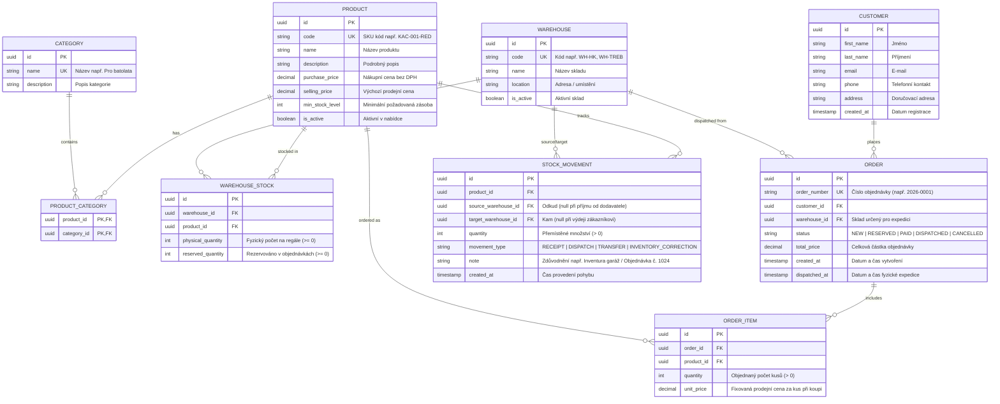
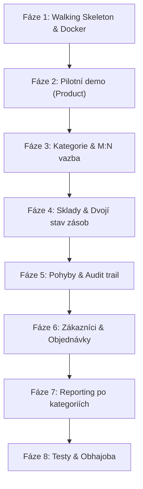

# Sklad pro malý e-shop (Dřevěnka s.r.o.)
> **Semestrální projekt z předmětu Pokročilé programování (PPRO)**  
> Fakulta informatiky a managementu, Univerzita Hradec Králové, ZS 2026/2027  
> **Jediný zdroj pravdy (Single Source of Truth – SSOT):** Technická dokumentace, kompletní zadání, seznam architektonických rozhodnutí a deník vývoje.

---

## 📋 Obsah
1. [Základní informace](#-základní-informace)
2. [Zásady a pravidla repozitáře](#-zásady-a-pravidla-repozitáře)
3. [Zadání klienta a analýza domény](#-zadání-klienta-a-analýza-domény)
4. [Povinné technické minimum projektu](#-povinné-technické-minimum-projektu)
5. [Rozhodnutí (Architecture Decision Records – ADR)](#-rozhodnutí-architecture-decision-records--adr)
6. [Datový model a doménové entity](#-datový-model-a-doménové-entity)
7. [Architektura a vrstvy systému](#-architektura-a-vrstvy-systému)
8. [Uživatelské rozhraní a ergonomie (UI/UX)](#-uživatelské-rozhraní-a-ergonomie-uiux)
9. [Instalace a spuštění](#-instalace-a-spuštění)
10. [Celkový fázový plán vývoje projektu (Roadmap)](#-celkový-fázový-plán-vývoje-projektu-roadmap)
11. [Implementační plán – Pilotní demo](#-implementační-plán--pilotní-demo-správa-entit-product)
12. [Deník postupu a historie změn (Changelog)](#-deník-postupu-a-historie-změn-changelog)

---

## 📌 Základní informace
- **Zadání:** B – Sklad pro malý e-shop
- **Klient:** Petr Doležal, jednatel *Dřevěnka s.r.o.* (zakázková výroba a prodej tradičních dřevěných hraček)
- **Vyučující / konzultant:** Dominik Palla (`dominik.palla@uhk.cz`)
- **Vzdálený repozitář:** `https://github.com/ZdenekPese/ppro2026.git`
- **Kde se návrh láme:** **Okamžik odečtení zásoby a dohledatelnost skladových pohybů**.

---

## ⚙️ Zásady a pravidla repozitáře

Tento repozitář podléhá striktním zásadám vývoje definovaným v zadání předmětu a v pravidlech projektu:

1. **Explicitní povel pro Git Push:**
   - Žádný nástroj ani agent **nesmí provést operaci `git push` bez výslovného a jednoznačného příkazu uživatele** v chatu.
2. **README.md jako Jediný zdroj pravdy (SSOT):**
   - Veškeré požadavky, architektonická a datová rozhodnutí, popis rozhraní a stav realizace jsou udržovány v tomto dokumentu.
   - Neexistuje oddělená nezaznamenaná dokumentace – kód a dokumentace se vyvíjejí ruku v ruce.
3. **Předcommitová kontrola (Git Pre-Commit Hook):**
   - Repozitář má nakonfigurovaný Git hook (verzovaný v `.githooks/pre-commit` a aktivní v lokálním `.git/hooks/pre-commit` s `core.hooksPath = .githooks`), který před každým commitem ověřuje, zda byly se změnami v kódu provedeny také patřičné záznamy v [README.md](file:///c:/Users/zzden/OneDrive/Dokumenty/ppro2026/README.md).
4. **Respekt k roli klienta na cvičeních:**
   - Klient může v průběhu semestru upřesnit či změnit zadání. Návrh systému je koncipován modulárně, aby takové změny ustál bez nutnosti kompletního přepracování.
5. **Použití výhradně syntetických dat:**
   - V repozitáři ani v databázi nesmí být uložena žádná reálná osobní data, produkční hesla či tajné klíče.

---

## 📦 Zadání klienta a analýza domény

### Výchozí situace klienta
Firma *Dřevěnka s.r.o.* funguje 10 let. V posledních třech letech dynamicky roste objem prodejů přes e-shop. Aktuální stav:
- Evidence cca 400 skladových položek probíhá v jednom sdíleném souboru v MS Excel, který mají současně otevřený 3 pracovníci na různých počítačích.
- Společnost má **dva sklady**:
  1. **Hlavní sklad v Hradci Králové** – expedice většiny běžných objednávek.
  2. **Druhý sklad (garáž v Třebechovicích pod Orebem)** – odkládání sezónního zboží a nadnormativních zásob.
- Objednávky přicházejí z e-shopu do e-mailu a skladníci je ručně přepisují.
- **Kritický problém:** Přibližně 2× měsíčně se prodá zboží, které již fyzicky není na skladě. Klient musí volat zákazníkům a omlouvat se, což poškozuje reputaci firmy a způsobuje zbytečné ztráty času.

### 1. Co klient chce (Funkční požadavky – povinné)
1. **Produkty a kategorie:** Produkt má název, kód (SKU), popis, nákupní cenu a prodejní cenu. Kategorií je více a produkt může patřit do několika kategorií současně (např. tatáž káča je „pro batolata“ i „dárky do 500 Kč“ – vazba M:N).
2. **Zásoby po skladech:** U každého produktu musí být přehledně vidět, kolik kusů leží v Hradci a kolik v garáži v Třebechovicích.
3. **Objednávky zákazníků:** Objednávka obsahuje identifikaci zákazníka, datum vytvoření, aktuální stav a jednotlivé položky (objednané množství a prodejní cena v okamžiku prodeje).
4. **Odmítnutí objednávky při nedostatku zásob:** Systém nesmí dovolit přijmout či potvrdit objednávku na zboží, které není disponibilní (klíčový byznys cíl).
5. **Dohledání pohybu (Audit trail):** Ke každému výdeji, příjmu či převodu musí být jednoznačně evidováno, ze kterého skladu se vydalo/přijalo, kdy a proč („kde je ta káča, co jsem ji měl minulý týden“).
6. **Přesun mezi sklady:** Možnost evidovat převoz zboží ze zimní garáže v Třebechovicích do Hradce Králové a opačně.
7. **Minimální zásoba a doporučení doobjednání:** Seznam produktů, jejichž stav klesl pod definovanou minimální hladinu, viditelný přímo na úvodním panelu.
8. **Měsíční obrat po kategoriích:** Finanční přehled prodejů seskupený dle kategorií za vybraný měsíc pro vyhodnocení ziskovosti sortimentu.

### 2. Na čem klient trvá (Obchodní pravidla – vynucená aplikací)
- **Zákaz výdeje do záporu:** Vydat víc zboží, než je reálně na daném skladě, nesmí jít ani omylem, ani ručně.
- **Neměnnost ceny v objednávce:** Cena v již přijaté/odeslané objednávce se nesmí zpětně změnit, pokud dojde k plošné úpravě ceníku produktů.
- **Dohledatelnost každé změny stavu:** Každá změna skladové zásoby musí mít odpovídající záznam o pohybu (kdo, kdy, kolik, odkud, kam, z jakého důvodu).
- **Zákaz mazání zákazníků:** Zákaznické karty se nesmí fyzicky mazat z databáze z důvodu historie nákupů a řešení případných reklamací.

### 3. Co klient prohodí mimochodem (Přání a ergonomie)
- *„Poštovné řešit nemusíme, to počítá e-shop.“* -> Logiku výpočtu přepravného nerealizujeme ve skladovém jádře.
- *„Ať to jde používat i z mobilu, já jsem půlku dne ve skladu.“* -> Responzivní, ergonomické rozhraní použitelné na tabletu/telefonu přímo u regálu.
- *„Faktury zatím ne, ale jednou určitě.“* -> Datový model připravit tak, aby šla vazba na fakturaci jednoduše napojit.
- *„Nejradši bych to měl barevně, ať vidím, co hoří.“* -> Přehledný dashboard s barevnou indikací kriticky nízkých zásob (červená = pod minimem, oranžová = blízko limitu, zelená = v pořádku).

---

## 🎯 Povinné technické minimum projektu

| Požadavek ze zadání | Způsob splnění v projektu |
| :--- | :--- |
| **Tři vrstvy se závislostmi jedním směrem** | 1. Prezentační vrstva (REST API / UI)<br>2. Aplikační a doménová vrstva (Byznys logika, služby, validace)<br>3. Persistenční / Infrastrukturní vrstva (ORM, Migrace, DB) |
| **Relační databáze v Dockeru** | PostgreSQL běžící v kontejneru v rámci `docker-compose.yml` |
| **Databázové migrace** | Řízené migrace verzované v repozitáři (např. EF Core Migrations nebo Flyway/Prisma) |
| **Nejméně 5 entit** | Navrženo 8 klíčových entit (`Product`, `Category`, `ProductCategory`, `Warehouse`, `WarehouseStock`, `StockMovement`, `Customer`, `Order`, `OrderItem`) |
| **Alespoň jedna vazba M:N** | Vazba `Product` $\leftrightarrow$ `Category` přes asociační entitu `ProductCategory` (plus vazba položek objednávky `Order` $\leftrightarrow$ `Product` přes `OrderItem`) |
| **Automatizované testy** | Unit a integrační testy pro klíčová pravidla (zákaz záporného stavu, rezervace zásob, neměnnost cen, audit pohybů) |
| **Spuštění jedním příkazem** | Kompletní běh aplikace včetně databáze přes `docker compose up` |
| **Technická dokumentace** | Vedení [README.md](file:///c:/Users/zzden/OneDrive/Dokumenty/ppro2026/README.md) jako jediného zdroje pravdy (SSOT) |
| **Bezpečnost a data** | Žádné reálné osobní údaje, pouze syntetická demo data, hesla mimo VCS |

---

## 🧠 Rozhodnutí (Architecture Decision Records – ADR)

V souladu s pokyny zadání pro otevřené body klienta zde definujeme jednoznačná rozhodnutí.

### ADR 1: Objednávka ze dvou skladů naráz a poštovné
- **Zadání klienta:** Na dotaz odpovídá *„asi jo, ale to poštovné“* a dál to nerozvede.
- **Rozhodnutí:** Objednávka zákazníka se standardně expeduje z jednoho centrálního skladu (Hradec Králové). Pokud některé zboží v Hradci chybí, ale nachází se v Garáži v Třebechovicích, systém objednávku nezamítne, nýbrž automaticky vygeneruje požadavek na **vnitroskladový převoz (Transfer)** z Třebechovic do Hradce.
- **Zdůvodnění:** Odesílání dvou samostatných zásilek zákazníkovi by znamenalo dvojí poštovné a zmatení zákazníka. Převoz zboží mezi sklady odpovídá běžné praxi klienta a šetří náklady na dopravu.

### ADR 2: Co znamená „dost zásob“ a okamžik odečtení zásoby
- **Zadání klienta:** Není jasné, zda se počítá fyzický stav, nebo stav snížený o rezervace, a kdy se zásoba odečítá.
- **Rozhodnutí:** Zavádíme dvoustupňový model zásoby:
  $$\text{Disponibilní zásoba} = \text{Fyzická zásoba na skladě} - \text{Rezervováno v otevřených objednávkách}$$
  Při přijetí/vytvoření objednávky dochází k okamžité **rezervaci** disponibilní zásoby. K **fyzickému odpisu** (vyskladnění) dochází až při samotné expedici zboží a předání dopravci.
- **Zdůvodnění:** Okamžitá rezervace zabraňuje přeprodeji stejného zboží (splněn bod 4 zadání). Fyzický odpis při expedici odpovídá reálnému stavu polic ve skladu a umožňuje případné storno bez nutnosti složitých zpětných naskladnění.

### ADR 3: Záporný stav a inventurní nesrovnalosti
- **Zadání klienta:** V garáži stav *„nikdy nesedí“*. Neřekl, zda zápor zakázat, nebo umožnit inventuru.
- **Rozhodnutí:** Záporný stav zásob je v celém systému striktně **zakázán** na úrovni databázových i aplikačních integritních omezení (`quantity >= 0`). Nesrovnalosti v garáži i v Hradci se řeší modulem **Inventura / Vyrovnání skladu**, který umožní přepsat evidovaný stav na skutečný zjištěný počet a rozdíl (přebytek či manko) zaeviduje jako samostatný auditní pohyb se zdůvodněním.
- **Zdůvodnění:** Povolení záporných zásob deformuje výpočet ziskovosti, minimálních zásob i plánování nákupů. Inventurní záznam zachovává čisté účetnictví i dohledatelnost chyb.

### ADR 4: Varianty produktu (SKU vs. vlastnosti)
- **Zadání klienta:** Mluví o *„té samé káče ve třech barvách“*. Zda je to samostatný produkt, či vlastnost, nerozliší.
- **Rozhodnutí:** Každá varianta (např. červená káča, modrá káča) má svůj **vlastní unikátní kód (SKU)** a je samostatnou skladovou jednotkou s vlastní evidencí počtu kusů. Varianty jsou sdruženy pod společný rodičovský produkt a sdílejí popis a kategorie.
- **Zdůvodnění:** Skladník v regálu musí přesně vědět, kolik červených káč má na skladě; nelze mít skladem „3 káče obecně“, pokud zákazník očekává konkrétní barvu.

### ADR 5: Změna objednávky po zaplacení
- **Zadání klienta:** Stává se to a dnes se to řeší telefonem; co má systém dovolit, klient neví.
- **Rozhodnutí:** Dokud objednávka není fyzicky expedována, systém umožňuje její úpravu pověřenou osobou:
  - Odebrání položky okamžitě uvolní její rezervaci a vygeneruje přeplatek.
  - Přidání položky je dovoleno pouze v případě, že je daná položka volně disponibilní na skladě (systém vygeneruje doplatek).
  Po expedici (vyskladnění) je objednávka uzamčena proti změnám a jakýkoliv další požadavek zákazníka se řeší jako nová objednávka nebo vratka/reklamace.
- **Zdůvodnění:** Chrání sklad před odesláním neúplného či nezaplaceného zboží a udržuje soulad mezi platbou, rezervací a fyzickým výdejem.

### ADR 6: Volba technologického stacku (Python ekosystém)
- **Rozhodnutí:** Projekt bude realizován v programovacím jazyce **Python (3.11+)** s využitím moderního webového frameworku **FastAPI**, relační databáze **PostgreSQL 16**, ORM nástroje **SQLAlchemy 2.0** a migračního systému **Alembic**. Pro pilotní klientské rozhraní se využije šablonovací engine **Jinja2 s responzivním Vanilla CSS** a automatická interaktivní dokumentace **OpenAPI / Swagger UI**.
- **Zdůvodnění:** Python a FastAPI umožňují čisté oddělení tří vrstev, striktní typování pomocí Pydantic schémat, automatickou tvorbu API dokumentace pro e-shop a rychlé nasazení do Docker kontejnerů s minimální režií.

---

## 🗄️ Datový model a doménové entity

Navržený datový model plně pokrývá požadavky na minimálně 5 entit, M:N vazby a auditní sledování pohybů:



### Popis klíčových vazeb a integritních pravidel
1. **M:N Vazba produktů a kategorií (`PRODUCT_CATEGORY`):** Každý produkt může náležet do libovolného počtu kategorií současně.
2. **Auditní stopa pohybů (`STOCK_MOVEMENT`):** Každá změna v tabulce `WAREHOUSE_STOCK` musí být doprovázena vložením záznamu do `STOCK_MOVEMENT`. Zajišťuje 100% zpětnou dohledatelnost („kde je ta káča...“).
3. **Fixace ceny v `ORDER_ITEM`:** Pole `unit_price` zachycuje okamžitou cenu v době nákupu; budoucí přecenění v tabulce `PRODUCT` tuto hodnotu nikdy neovlivní.
4. **Trvalost zákazníka (`CUSTOMER`):** Záznamy zákazníků se nemažou (pouze případně označí jako neaktivní), aby byly zachovány vazby pro reklamace.

---

## 🏛️ Architektura a vrstvy systému

Aplikace je navržena striktně podle požadavku na **tři vrstvy se závislostmi jedním směrem**:

```
+-----------------------------------------------------------------------------------+
|                           1. PREZENTAČNÍ VRSTVA                                   |
|  - Webové rozhraní pro skladníka (FastAPI + Jinja2 + Responsive Vanilla CSS)      |
|  - REST API routery pro e-shop (/api/products, /api/orders, Swagger UI na /docs)  |
+-----------------------------------------------------------------------------------+
                                          |
                                          v (závisí na)
+-----------------------------------------------------------------------------------+
|                      2. APLIKAČNÍ A DOMÉNOVÁ VRSTVA                               |
|  - Byznys služby (ProductService, StockService, OrderService)                      |
|  - Validace doménových pravidel (Pydantic validátory, kontrola záporu a rezervací)|
|  - Doménové výjimky a transakční hranice                                          |
+-----------------------------------------------------------------------------------+
                                          |
                                          v (závisí na)
+-----------------------------------------------------------------------------------+
|                   3. PERSISTENČNÍ A INFRASTRUKTURNÍ VRSTVA                        |
|  - Repozitáře (ProductRepository, StockRepository)                                |
|  - SQLAlchemy 2.0 mapování, relace a constraints                                 |
|  - Verzované databázové migrace přes Alembic                                      |
|  - PostgreSQL 16 v Docker kontejneru                                              |
+-----------------------------------------------------------------------------------+
```

---

## 🎨 Uživatelské rozhraní a ergonomie (UI/UX) – Standard 2026

Webové rozhraní je navrženo ve standardu moderních B2B SaaS a ERP aplikací roku 2026 (inspirováno systémy jako Linear, Katana Cloud Manufacturing nebo Shopify Warehouse). Rozhraní striktně odmítá levná AI klišé a emoji ikony – staví na čisté vektorové grafice (inline SVG), přehledné informační hierarchii a ergonomii pro skladníky u dotykových terminálů i manažery u velkých obrazovek.

### 1. Závazná barevná paleta (9 odstínů)
Design systém staví na vyladěné devítiúrovňové paletě přecházející od syté karmínové přes ametystovou až po hlubokou petroliovou modř:
- `#b7094c` (Primary Crimson) – Hlavní akcentní barva, branding, primární CTA tlačítka, aktivní linky.
- `#a01a58` (Crimson Hover / Accent 2) – Hover stavy primárních akcí a zvýraznění.
- `#892b64` (Wine / Accent 3) – Ohraničení aktivních prvků a jemné přechody.
- `#723c70` (Plum / Accent 4) – Sekundární akcenty a štítky.
- `#5c4d7d` (Purple Slate / Accent 5) – Přechodové prvky a indikátory.
- `#455e89` (Steel Slate / Accent 6) – Podkladové struktury, ohraničení karet a tabulek.
- `#2e6f95` (Ocean Blue / Accent 7) – Sekundární tlačítka, SKU badge ohraničení.
- `#1780a1` (Teal / Accent 8) – Informační indikátory a doplňkové grafické prvky.
- `#0091ad` (Cyan Teal / Accent 9) – Indikátory marží, pozitivních stavů a databázového propojení.

### 2. Typografie a informační hierarchie
- **UI & Nadpisy:** Google Font *Plus Jakarta Sans* (váhy 400, 500, 600, 700) pro maximální čitelnost a prémiový firemní vzhled.
- **SKU kódy, ceny a časová razítka:** Google Font *JetBrains Mono* (monospaced) pro nekompromisní čitelnost kódů hraček a zarovnání číselných hodnot.

### 3. Architektura rozhraní (ERP Shell)
- **Profesionální postranní panel (Sidebar):**
  - Brand značka Dřevěnka s.r.o. s logem a indikací verze systému.
  - Vektorová navigace se sémantickými SVG ikonami (Katalog, Sklady, Pohyby, Objednávky, Zákazníci, Reporty, API Swagger).
  - Přímý status monitor obou skladových uzlů: **Centrální sklad Hradec Králové** a **Sklad Třebechovice pod Orebem** s live indikátorem dostupnosti.
- **Top Bar a Drobečková navigace:**
  - Kontextová navigace s indikací aktuální lokace v systému.
  - Stav spojení na PostgreSQL 16 v reálném čase.
- **Metrické karty (KPI Overview):**
  - Okamžitý přehled nad katalogem: *Celkem položek*, *Aktivní v prodeji*, *Průměrná prodejní cena*, *Průměrná marže*.
- **Přehledová tabulka a formuláře:**
  - Bohaté tabulky s jemným hover efektem, monospaced SKU štítky, barevně odlišenými cenovými hladinami a marží.
  - Rychlé fulltextové vyhledávání s okamžitým resetem.
  - Dvou-sloupcové přehledné editační formuláře s inline nápovědou a validací.

---

## 🚀 Instalace a spuštění

Celé prostředí včetně relační databáze je připraveno ke spuštění pomocí **Docker Compose**:

### 1. Prerekvizity
- Docker Desktop a Docker Compose v aktuální verzi
- Git

### 2. Spuštění aplikace
V kořenovém adresáři projektu spusťte:
```bash
docker compose up --build
```
Tento příkaz:
1. Spustí kontejner s relační databází (PostgreSQL).
2. Provede automatické databázové migrace na nejnovější verzi schématu.
3. Naplní databázi syntetickými počátečními daty (katalog hraček, 2 sklady, demo zákazníci).
4. Spustí aplikační server a zpřístupní webové rozhraní.

### 3. Spuštění testů
```bash
# Spuštění automatizovaných testů byznys pravidel a integrity
docker compose run --rm app-tests
```

---

## 🗺️ Celkový fázový plán vývoje projektu (Roadmap)

Pro přehledný, iterativní a bezpečný vývoj je projekt rozdělen do **8 logických fází** podle principu *Tracer Bullet / Walking Skeleton* (od tenké spustitelné vertikály k postupnému nabalování doménové logiky):



| Fáze | Název fáze | Klíčový cíl a náplň | Hlavní výstup |
| :--- | :--- | :--- | :--- |
| **Fáze 1** | **Walking Skeleton & Infrastruktura** | Docker Compose (`app` + `db`), PostgreSQL 16, konfigurace SQLAlchemy 2.0 a Alembic migrací. | Běžící skeleton na 1 příkaz, `/docs` a `/health`. |
| **Fáze 2** | **Pilotní demo – Správa produktů (`Product`)** | Kompletní 3vrstvá vertikála pro dřevěné hračky: ORM, repozitář, service s validací marží/cen, REST API a responzivní web UI. | **Demo pro klienta/vyučujícího na cvičení** pro 1. feedback. |
| **Fáze 3** | **Kategorie a M:N vazba (`Category`)** *(Dokončeno)* | Zavedení kategorií a vazební tabulky `product_categories` (splnění povinného minima M:N). Filtrování a výběr kategorií v katalogu i formuláři. | Tatáž hračka ve více kategoriích naráz (káča pro batolata i dárky do 500 Kč). |
| **Fáze 4** | **Sklady a Zásoby (`Warehouse`, `Stock`)** *(Dokončeno)* | Evidence 2 skladů (Hradec Králové vs. Garáž Třebechovice). Dvoustupňový model: fyzická vs. rezervovaná zásoba. Barevný dashboard na úvodní stránce. | Barevný dashboard „co hoří“ pod minimem a matice skladů. |

| **Fáze 5** | **Pohyby a Auditní stopa (`StockMovement`)** *(Dokončeno)* | Vynucení zákazu záporu (`quantity >= 0`). Audit 100 % pohybů (příjem, transfer Hradec-Třebechovice, inventurní vyrovnání). | Zpětná dohledatelnost („kde je ta káča...“) a správa převozů a inventury. |
| **Fáze 6** | **Zákazníci a Objednávky (`Customer`, `Order`)** *(Dokončeno)* | Rezervace při objednání, neměnnost prodejní ceny v `OrderItem`, fyzický odpis při expedici, zákaz mazání zákazníků. | Kompletní nákupní a expediční proces z e-shopu s ochranou před přeprodejem. |
| **Fáze 7** | **Reporting a Analytika** *(Dokončeno)* | Měsíční obrat po kategoriích, přehled ziskovosti sortimentu dřevěných hraček a automatický plán doobjednání a meziskladových převozů (ADR 1). | Manažerský reporting, analytické výkazy a akční plán doplňování zásob pro Petra Doležala. |
| **Fáze 8** | **Testy, optimalizace a Obhajoba** | Komplexní sada unit/integračních testů v `pytest`, revize SSOT dokumentace, finální verifikace před odevzdáním. | Projekt připravený k bezchybné obhajobě. |

---

## 🛠️ Implementační plán – Pilotní demo (Správa entit Product)

Cílem pilotního dema je vytvořit **funkční, minimální, ale architektonicky kompletní vertikálu** (všechny 3 vrstvy + DB + Docker) spravující centrální entitu systému: **`Product` (Dřevěná hračka)**. Toto demo bude předvedeno klientovi (vyučujícímu) pro získání první zpětné vazby.

### Proč právě entita `Product`?
1. Je to ústřední byznys entita firmy *Dřevěnka s.r.o.* (hračky, káči, koníci, vláčky).
2. Okamžitě demonstruje nahrazení chaotické excelovské tabulky strukturovaným katalogem.
3. Demonstruje povinné atributy zadání: název, SKU kód, popis, nákupní cena, prodejní cena, minimální zásoba.
4. Připravuje půdu pro navázání kategorií (M:N) a skladových zásob (Hradec Králové vs. Třebechovice).

### Fáze realizace pilotního dema:

```
[Krok 1: Kostra projektu] ---> [Krok 2: Persistenční vrstva] ---> [Krok 3: Aplikační logika]
(Dockerfile, Compose, DB)      (SQLAlchemy, Alembic migrace)      (Pydantic, ProductService)
                                                                           |
[Krok 6: Předvedení klientovi]<-- [Krok 5: Testy a seed dat] <--- [Krok 4: Prezentační vrstva]
(Zpětná vazba, cvičení)        (pytest, demo data hraček)         (REST API + Webové UI)
```

#### Krok 1: Inicializace skeletonu, Dockeru a databáze
- Vytvoření souborů `Dockerfile`, `docker-compose.yml`, `requirements.txt` a `.env.example`.
- Nastavení služeb:
  - `db`: PostgreSQL 16 s trvalým svazkem (volume) a healthcheckem.
  - `web`: Python 3.11+ / FastAPI aplikace s automatickým reloadem pro vývoj.
- Nastavení centrálního konfiguračního modulu `app/core/config.py` a správy DB spojení `app/core/database.py`.

#### Krok 2: Persistenční vrstva (Infrastruktura a migrace)
- Inicializace migračního nástroje **Alembic** (`alembic/`).
- Definice ORM modelu `Product` v `app/infrastructure/db/models.py` (včetně kontrolních omezení `selling_price >= 0`, `purchase_price >= 0` a unikátnosti `code`).
- Vytvoření a aplikace první migrace `001_create_products_table`.
- Implementace `ProductRepository` v `app/infrastructure/repositories/product_repository.py` (metody `list_all`, `get_by_id`, `get_by_code`, `create`, `update`, `delete/deactivate`).

#### Krok 3: Aplikační a doménová vrstva (Byznys logika)
- Definice DTO / Pydantic schémat v `app/domain/models/product.py`:
  - `ProductCreate`, `ProductUpdate`, `ProductResponse`.
- Implementace doménových výjimek v `app/domain/exceptions.py` (`ProductNotFoundError`, `DuplicateProductCodeError`, `InvalidPriceError`).
- Implementace `ProductService` v `app/domain/services/product_service.py` s validací byznys pravidel:
  - Zajištění unikátnosti SKU kódu před uložením.
  - Kontrola, že prodejní cena je vyšší než nákupní (varování / validace marže).
  - Validace nezápornosti cen a minimální skladové hladiny.

#### Krok 4: Prezentační vrstva (REST API a Web UI pro klienta)
- **REST API:**
  - Vytvoření routeru `app/presentation/api/product_router.py` s endpointy:
    - `GET /api/products` (seznam s možností filtrování / vyhledávání)
    - `GET /api/products/{id}` (detail produktu)
    - `POST /api/products` (založení nového produktu)
    - `PUT /api/products/{id}` (úprava cen, minimální zásoby či popisu)
  - Automatická interaktivní dokumentace na `/docs` (Swagger UI).
- **Web UI pro skladníka a klienta:**
  - Šablony Jinja2 v `app/presentation/templates/`:
    - `base.html` – přehledný layout, responzivní pro mobil i desktop.
    - `product_list.html` – katalog dřevěných hraček, vyhledávací pole, barevné indikátory cen a stavů.
    - `product_form.html` – intuitivní formulář pro přidání/editaci hračky.
  - Vlastní čistý CSS styl `app/presentation/static/css/style.css` (moderní design, žádné zbytečné externí knihovny, ergonomické pro mobilní skladníky).

#### Krok 5: Syntetická data a automatizované testy
- Vytvoření seedovacího skriptu s realistickými dřevěnými hračkami Dřevěnky (např. *Buková káča*, *Dřevěný vláček s vagóny*, *Tahací kačer*, *Houpací koník*, *Stavebnice z kostek*).
- Zavedení automatizovaných testů pomocí `pytest`:
  - Unit testy `ProductService` (validace cen, ošetření duplicitního kódu).
  - Integrační test API endpointů.

---

## 📝 Deník postupu a historie změn (Changelog)

- **2026-09-30 (Fáze 0 – Inicializace a stanovení SSOT):**
  - Inicializován Git repozitář a nastavena hlavní větev `main`.
  - Propojen vzdálený repozitář `https://github.com/ZdenekPese/ppro2026.git`.
  - Nastaveno pravidlo repozitáře: **striktní zákaz automatického pushování bez explicitního povelu uživatele**.
  - Zaveden Git pre-commit hook (`.git/hooks/pre-commit`) vynucující synchronizaci kódu a dokumentace.
  - Vytvořena komplexní technická dokumentace a rozpracována rozhodnutí pro **Zadání B (Sklad pro malý e-shop - Dřevěnka s.r.o.)**.
  - Vytvořen kořenový konfigurační soubor [AGENTS.md](file:///c:/Users/zzden/OneDrive/Dokumenty/ppro2026/AGENTS.md) definující pravidla a standardy pro AI asistenty.
  - Zaveden verzovaný Git hook v `.githooks/pre-commit` a nastaveno `git config core.hooksPath .githooks`.
  - Schválen technologický stack (Python 3.11+, FastAPI, PostgreSQL 16, SQLAlchemy 2.0, Alembic) – zaznamenáno v ADR 6.
  - Vypracován podrobný implementační plán pro pilotní demo spravující entitu `Product`.
- **2026-10-07 (Fáze 0 – Strukturování etap projektu):**
  - Rozpracována celková 8fázová roadmapa vývoje celého projektu od skeletonu po finální obhajobu.
  - Aktualizována pravidla v [AGENTS.md](file:///c:/Users/zzden/OneDrive/Dokumenty/ppro2026/AGENTS.md) pro fázový iterativní postup.
- **2026-10-07 (Fáze 1 – Walking Skeleton & Infrastruktura dokončena):**
  - Vytvořen `Dockerfile` (Python 3.12-slim) a `docker-compose.yml` (služby `web` a `db` s PostgreSQL 16 a healthcheckem).
  - Vytvořena konfigurace závislostí `requirements.txt` a vzor `.env.example`.
  - Založena modulární třívrstvá struktura projektu (`core`, `domain`, `infrastructure`, `presentation`).
  - Nastaveno databázové spojení SQLAlchemy v `app/core/database.py` a migrační nástroj Alembic (`alembic.ini`, `alembic/env.py`).
  - Implementován `health_router` na `/api/health` s testem spojení na databázi.
  - Vytvořen základní responzivní design systém v `app/presentation/static/css/style.css` a Jinja2 layout `base.html`.
  - Upraveno volání `TemplateResponse` pro plnou kompatibilitu s novějšími verzemi Starlette/FastAPI.
  - Přidány základní unit testy v `tests/test_health.py` (úspěšně ověřeny v běžícím Docker kontejneru).
- **2026-10-07 (Fáze 2 – Pilotní demo: Správa produktů Product dokončena):**
  - Vytvořen SQLAlchemy ORM model `Product` s integritními omezeními (unikátní SKU, nezáporné ceny, nezáporná minimální zásoba).
  - Vygenerována a aplikována 1. databázová migrace `b996581df047_create_products_table.py` přes Alembic.
  - Implementován `ProductRepository` s metodami CRUD a fulltextovým vyhledáváním.
  - Vytvořena doménová a byznys vrstva: Pydantic schémata (`ProductCreate`, `ProductUpdate`, `ProductResponse`), výjimky a `ProductService` s validací pravidel.
  - Vytvořeno REST API rozhraní `/api/products` (CRUD operace, Swagger na `/docs`).
  - Vytvořeno webové klientské UI na `/products` s katalogem dřevěných hraček, vyhledáváním a formulářem pro přidání a editaci položky.
  - Vytvořen seedovací skript `app/infrastructure/db/seed.py` naplňující 5 typických hraček Dřevěnky (Káča, Vláček, Tahací kačer, Houpací koník, Kostky).
  - Napsány automatizované testy v `tests/test_products.py` (ověření unikátnosti SKU, odmítnutí záporných cen, vyhledávání). Všech 6 testů úspěšně prochází.
- **2026-10-19 (Konfigurace IDE a typové kontroly):**
  - Přidána konfigurace `pyproject.toml`, `pyrightconfig.json` a `.vscode/settings.json`.
  - Pomocí moderního nástroje `uv` bylo v projektu inicializováno plnohodnotné lokální virtuální prostředí `.venv` s nativním Pythonem 3.12.15 a všemi závislostmi.
  - Editor nyní disponuje plně funkčním interpretrem a bezchybným IntelliSense.
  - Aktualizována idempotence testů v `tests/test_products.py`. Všechny testy procházejí jak lokálně, tak v Docker kontejneru.
- **2026-10-19 (Kompletní 2026 Redesign webového rozhraní):**
  - Proveden kompletní redesign webového rozhraní dle standardu moderních B2B ERP/SaaS systémů (Linear, Katana ERP) a přísných ergonomických požadavků klienta.
  - Využita závazná devítiúrovňová barevná paleta: `["#b7094c", "#a01a58", "#892b64", "#723c70", "#5c4d7d", "#455e89", "#2e6f95", "#1780a1", "#0091ad"]`.
  - Striktně odstraněny veškeré emoji a AI klišé prvky; implementována čistá vektorová inline SVG grafika pro všechny navigační i akční prvky.
  - Nasazena moderní čitelná typografie (Google Fonts *Plus Jakarta Sans* a *JetBrains Mono* pro SKU kódy a číselné hodnoty).
  - V `product_list.html` nahrazeny generické 4 karty kompaktním a přehledným vertikálním seznamem metrik pod sebou na levé straně (*Položky v katalogu*, *Aktivní v prodeji*, *Průměrná prodejní cena*, *Průměrná marže dílny*) s barevnými indikátory z palety.
  - Přepracován editační formulář `product_form.html` na čisté dvou-sloupcové rozvržení se strukturovanými poli pro marži, nákupní a prodejní cenu.
  - Vyřešeno nežádoucí nafukování SVG ikon způsobené mezipamětí prohlížeče přidáním striktních rozměrových atributů `width="16" height="16"`, inline stylu a globální CSS pojistky.
  - Přepracováno rozvržení na přehledný a vzdušný Top Navigation Bar s live indikátory skladů (Hradec Králové vs. Třebechovice) a maximální šířkou kontejneru 1320px pro přehlednou práci u regálu.
  - Všech 6 automatizovaných testů v `pytest` úspěšně prochází.
- **2026-10-20 (Oprava typových chyb Pydantic a zesvětlení rozhraní):**
  - Opravena neshoda typů u validačních pravidel `ge=0` v Pydantic schématech `purchase_price` a `selling_price` v `app/domain/models/product.py` na `ge=Decimal(0)`.
  - Zesvětleny podkladové plochy rozhraní z příliš tmavé černé na příjemnou, svěží břidlici (`--bg-body: #182234`, `--bg-card: #233148`) s vyšším kontrastem a jasnější typografií.
  - Ponechány tóny všech 9 barev ze zadané palety, přičemž byly znatelně zesvětleny a rozzářeny pro maximální čitelnost prvků, marží a tlačítek.
  - Přidán `uv.lock` do `.gitignore`. Všech 6 testů `pytest` úspěšně prochází.
- **2026-10-20 (Ošetření maximální ceny a chybové hlášky u inputu):**
  - Identifikována příčina `500 Internal Server Error`: databázový sloupec `Numeric(10, 2)` povoluje maximální částku `99 999 999.99 Kč`. Při zadání vyšší částky docházelo k nevrácení výjimky z databáze (`DataError: numeric field overflow`).
  - Zavedeno validační pravidlo `le=MAX_PRICE` (`Decimal("99999999.99")`) na úrovni Pydantic schémat i doménové služby `ProductService`.
  - Do webového formuláře `product_form.html` přidány atributy `max="99999999.99"` a inline vizualizace chyb u konkrétních polí (`.input-error`, `.field-error`).
  - Router `product_web_router.py` a repozitář byly zabezpečeny: chyby `DataError` a `SQLAlchemyError` jsou bezpečně zachyceny s rollbackem transakce a vráceny jako HTTP 422 s chybovou hláškou přímo u inputu ceny.
  - Rozšířena sada automatizovaných testů v `tests/test_products.py` na celkových 9 testů (pokrývající limit cen v API, při zakládání i editaci produktu). Všech 9 testů prochází.
- **2026-10-21 (Fáze 3 – Kategorie a M:N vazba Category <-> Product dokončena):**
  - Implementován SQLAlchemy ORM model `Category` a asociační vazební tabulka `product_categories` s kaskádovým mazáním (`ondelete="CASCADE"`) a vzájemnou relací s `lazy="selectin"` (eliminace N+1 dotazů).
  - Vygenerována a aplikována nová Alembic migrace `5d6604bc6566_create_categories_and_product_categories.py`.
  - Vytvořena doménová vrstva pro kategorie: Pydantic schémata (`CategoryBase`, `CategoryCreate`, `CategoryUpdate`, `CategoryResponse`), doménové výjimky `CategoryNotFoundError`, `DuplicateCategoryNameError` a byznys služba `CategoryService`.
  - Rozšířena schémata `ProductCreate` a `ProductUpdate` o parametr `category_ids: list[UUID]` a `ProductResponse` o `categories: list[CategoryResponse]`.
  - Implementována podpora filtrování produktů dle `category_id` v `ProductRepository` a `ProductService` pomocí dotazu `Product.categories.any(Category.id == category_id)`.
  - Vytvořen kompletní REST API router `app/presentation/api/category_router.py` pro CRUD operace kategorií (`/api/categories`) a integrován do `app/main.py`.
  - Rozšířen endpoint `GET /api/products` o filtrování dle `category_id`.
  - Aktualizováno klientské webové rozhraní:
    - V katalogu `product_list.html` přidán výběrový filtr kategorií, vizuální štítky přiřazených kategorií u každého produktu a metrika *Kategorie sortimentu* v levém přehledu metrik.
    - Ve formuláři `product_form.html` implementován interaktivní výběr více kategorií současně pomocí stylových přepínačů (pill chips).
  - Rozšířen seedovací skript `app/infrastructure/db/seed.py` o 5 reálných kategorií Dřevěnky (*Pro batolata*, *Dárky do 500 Kč*, *Dopravní prostředky*, *Stavebnice a hlavolamy*, *Tradiční hračky*) s přiřazením více kategorií jednotlivým hračkám (Káča splňuje explicitní požadavek zadání na současné zařazení do batolat i dárků do 500 Kč).
  - Přidána sada 7 nových integračních a unit testů v `tests/test_categories.py`. Všech 16 testů v projektu úspěšně prochází.
- **2026-10-21 (Fáze 4 – Sklady a Skladové zásoby Warehouse, WarehouseStock dokončena):**
  - Vytvořeny ORM modely `Warehouse` (sklady) a `WarehouseStock` (zásoby s vazbami na produkt a sklad) s integritními omezeními nezápornosti fyzických i rezervovaných kusů (`physical_quantity >= 0`, `reserved_quantity >= 0`, `reserved_quantity <= physical_quantity`) a unikátním párem `(warehouse_id, product_id)`.
  - Vygenerována a aplikována nová Alembic migrace `72a536a13c64_create_warehouses_and_warehouse_stocks.py`.
  - Vytvořena doménová a aplikační vrstva: Pydantic schémata (`WarehouseBase`, `WarehouseCreate`, `WarehouseResponse`, `WarehouseStockResponse`, `ProductStockDetail`, `DashboardSummary`), výjimky `WarehouseNotFoundError`, `DuplicateWarehouseCodeError`, `InsufficientStockError`, `NegativeStockError` a byznys služba `WarehouseService`.
  - Implementován dvoustupňový model zásob: $\text{Disponibilní} = \text{Fyzická} - \text{Rezervovaná}$. Metody pro rezervaci, uvolnění rezervace, fyzický odpis i ruční úpravu zásob.
  - Vytvořen REST API router `app/presentation/api/warehouse_router.py` pokrývající správu skladů (`/api/warehouses`), inventuru zásob (`/api/warehouses/{id}/stocks/{prod_id}`), rozpad zásob (`/api/stocks`) i dashboard souhrn (`/api/dashboard/summary`).
  - Vytvořeno webové rozhraní pro dashboard (`/` v `dashboard.html` a `dashboard_web_router.py`):
    - Přehledové karty skladů: Centrální sklad Hradec Králové (`WH-HK`) a Sezónní garáž Třebechovice pod Orebem (`WH-TREB`).
    - Barevná sekce „Co hoří“ pro položky s disponibilním množstvím pod minimální zásobou s doporučením převozu z garáže nebo výroby.
    - Kompletní matice stavu zásob rozpadlá po skladech s barevnými odznaky (červená pod minimem, oranžová blízko limitu, tyrkysová v pořádku) a filtrem `only_critical`.
    - V katalogu `/products` doplněna indikace disponibilní zásoby přímo u minimální hladiny.
  - Aktualizován seedovací skript `app/infrastructure/db/seed.py`: inicializovány oba sklady (`WH-HK`, `WH-TREB`) a naplněno 10 stavů zásob pro všech 5 hraček (včetně realistického scénáře, kde vláček a tahací kačer klesly pod minimum a vyžadují pozornost).
  - Přidána sada 6 nových integračních a unit testů v `tests/test_warehouses.py`. Celkem prochází všech 22 testů projektu v pytest.
- **2026-10-21 (Fáze 5 – Pohyby a Auditní stopa StockMovement dokončena):**
  - Implementován SQLAlchemy ORM model `StockMovement` s integritním omezením `CheckConstraint("quantity > 0")`, cizími klíči na produkt a zdrojový/cílový sklad (`SET NULL` při smazání skladu, `CASCADE` při smazání produktu) a indexovaným časovým razítkem `created_at` a typem `movement_type`.
  - Vygenerována a aplikována nová Alembic migrace `1dcb7e2afc1c_create_stock_movements_table.py`.
  - Vytvořena doménová vrstva pro skladové operace:
    - Enum `StockMovementType` (`receipt`, `dispatch`, `transfer`, `inventory_adjustment`).
    - DTO schémata `StockReceiptCreate`, `StockDispatchCreate`, `StockTransferCreate`, `InventoryAdjustmentCreate` a `StockMovementResponse`.
  - Vytvořen repozitář `StockMovementRepository` s metodami `create`, `get_by_id` a `list_all` (s filtry dle produktu, skladu, typu pohybu a stránkovacím limitem).
  - Vytvořena doménová a byznys služba `StockMovementService` vynucující klíčová pravidla zadání:
    - **Zákaz záporného stavu zásob (`quantity >= 0`):** Výdej i transfer nad disponibilní limit jsou striktně odmítnuty vyvoláním `InsufficientStockError`.
    - **Meziskladový přesun (Transfer):** Řešení požadavku klienta na transfer ze sezónní garáže Třebechovice do Hradce Králové. Provedeno atomicky v jediné databázové transakci.
    - **Inventurní vyrovnání (ADR 3):** Řešení situace, kdy v garáži „stav nesedí“. Umožňuje zadat skutečně nalezený fyzický počet s povinným auditním zdůvodněním; automaticky detekuje manko či přebytek a vytvoří příslušný auditní pohyb.
    - **100% dohledatelnost:** Každá manipulace má zaznamenán zdroj, cíl, datum, čas, počet kusů, číslo dokladu i textovou poznámku.
  - Vytvořen REST API router `app/presentation/api/stock_movement_router.py` pokrývající endpointy `GET /api/movements`, `POST /api/movements/receipt`, `POST /api/movements/dispatch`, `POST /api/movements/transfer`, `POST /api/movements/inventory-adjustment` a integrován do `app/main.py`.
  - Vytvořeno klientské webové rozhraní pro skladníky i vedení:
    - Stránka `/movements` (`stock_movements.html`) s kompletním auditním deníkem, filtrovací lištou dle produktu, skladu a typu pohybu, barevnými odznáčky operací a rychlými dlaždicemi pro založení pohybu.
    - Stránka `/movements/new` (`stock_movement_form.html`) se záložkovým přepínačem pro příjem, meziskladový transfer a inventurní dorovnání.
    - Do globální navigace (`base.html`) přidána položka *„Pohyby & Audit“* s aktivním stavem.
    - Doplněny vizuální styly v `app/presentation/static/css/style.css` (odznáčky `.pill-receipt`, `.pill-dispatch`, `.pill-transfer`, `.pill-adjustment`, form intro karty, tabs) v souladu s 9-barevnou paletou.
  - Aktualizován seedovací skript `app/infrastructure/db/seed.py` o vložení 5 realistických auditních pohybů (příjmy z truhlárny, převoz do HK, expedice zákazníkovi, inventura v garáži).
  - Přidána sada 8 nových integračních a unit testů v `tests/test_stock_movements.py` pokrývající příjem, výdej se zákazem záporu, validace převodu a inventurní manko i přebytek. Všech 30 testů v projektu úspěšně prochází.
- **2026-10-21 (Fáze 6 – Zákazníci a Objednávky Customer, Order, OrderItem dokončena):**
  - Implementovány SQLAlchemy ORM modely:
    - `Customer`: jméno, příjmení, e-mail, telefon, doručovací adresa, stav aktivity (zákaz fyzického mazání).
    - `Order`: unikátní číslo objednávky (`order_number`), vazba na zákazníka a expediční sklad, stavy `NEW`, `RESERVED`, `DISPATCHED`, `CANCELLED`, celková částka, čas vytvoření a expedice.
    - `OrderItem`: položka objednávky s `CheckConstraint("quantity > 0")`, `CheckConstraint("unit_price >= 0")` a fixovanou prodejní cenou v čase koupě.
  - Vygenerována a aplikována nová verzovaná migrace `2a2030e9ef30_create_customers_orders_and_order_items_.py`.
  - Vytvořena doménová vrstva a DTO:
    - Pydantic schémata zákazníků (`CustomerBase`, `CustomerCreate`, `CustomerUpdate`, `CustomerResponse`).
    - Pydantic schémata objednávek (`OrderStatus`, `OrderItemCreate`, `OrderCreate`, `OrderItemResponse`, `OrderResponse`).
    - Doménové výjimky `CustomerNotFoundError`, `CustomerDeletionForbiddenError`, `OrderNotFoundError`, `DuplicateOrderNumberError`, `InvalidOrderStatusError`.
  - Implementovány repozitáře `CustomerRepository` a `OrderRepository` (s automatickým generováním sekvenčních čísel objednávek).
  - Implementovány byznys služby `CustomerService` a `OrderService` vynucující klíčová pravidla:
    - **Okamžitá rezervace (ochrana před přeprodejem):** Při zadání objednávky se okamžitě navýší `reserved_quantity`, čímž se zamezí prodeji neexistujícího zboží (vyřešení největší bolesti pana Doležala).
    - **Neměnnost ceny v čase:** Jednotková cena položky se fixuje v `OrderItem.unit_price`. Pozdější přecenění produktu v katalogu cenu v existující objednávce nikdy nezmění.
    - **Zákaz mazání zákazníků:** Fyzické smazání zákazníka je blokováno; provádí se výhradně měkká deaktivace bez ztráty vazeb a historie reklamací.
    - **Dvoufázový odpis:** Fyzický odpis ze skladu se provádí až při expedici (`DISPATCHED`) s automatickým zápisem do auditní stopy `StockMovement` (typ `dispatch`).
    - **Uvolnění při stornu:** Při stornu se rezervované kusy vrátí do volného disponibilního prodeje.
  - Vytvořeny REST API routery `app/presentation/api/customer_router.py` a `app/presentation/api/order_router.py` a integrovány do `app/main.py`.
  - Vytvořeno webové rozhraní:
    - `/orders` (`orders.html`): přehled objednávek se stavovými záložkami (Všechny, K expedici, Odeslané, Stornované), vyhledáváním a upozorněním na nutnost převozu ze sezónní garáže.
    - `/orders/{id}` (`order_detail.html`): detail objednávky s kartou zákazníka, doručovací adresou, fixovanými cenami a akčními tlačítky pro expedici a storno.
    - `/orders/new` (`order_form.html`): formulář pro zadání objednávky s možností výběru stávajícího zákazníka nebo rychlého založení nového.
    - `/customers` (`customers.html`): adresář zákazníků s počty objednávek a indikátorem aktivity.
    - Doplněna navigace v `base.html` o odkazy *„Objednávky“* a *„Zákazníci“*, rozšířen `style.css` o styly objednávkových záložek a odznáčků.
  - Rozšířen seedovací skript `app/infrastructure/db/seed.py` o 3 demo zákazníky a 3 reálné objednávky (odeslanou i rezervované).
  - Vytvořena testovací sada `tests/test_orders.py` se 7 unit a integračními testy. Všech 37 testů v projektu úspěšně prochází.
- **2026-10-26 (Fáze 7 – Reporting a Analytika dokončena):**
  - **Měsíční obrat po kategoriích (Turnover by Category):**
    - Implementována doménová logika v `ReportService.get_monthly_category_turnover` vyhodnocující tržby a nákupní náklady za vybraný měsíc a rok.
    - Zohledněna M:N vazba mezi hračkami a kategoriemi přes `product_categories`: pokud daná hračka patří do více kategorií současně (např. *Buková káča* do *Pro batolata*, *Dárky do 500 Kč* a *Tradiční hračky*), její tržby se plnohodnotně započítávají do každé z těchto kategorií pro vyhodnocení poptávky.
    - Každá kategorie uvádí: počet prodaných kusů, počet unikátních objednávek, celkové tržby (Kč) spočtené z fixovaných cen `OrderItem`, nákupní náklady dílny, hrubý zisk (Kč), procentuální marži (%) a podíl kategorie na celkových tržbách s vizuálním progress barem.
  - **Dvourežimový finanční přehled (Ziskovost sortimentu):**
    - `ReportService.get_financial_summary`: souhrnná bilance e-shopu na celofiremní úrovni bez duplicitního započtení M:N kategorií.
    - Zahrnuje celkový obrat, nákupní náklady, hrubý zisk, průměrnou marži dílny (v %), celkový počet vyřízených objednávek a průměrnou hodnotu nákupního košíku.
    - Podporuje přepínání mezi čistě realizovanými tržbami (`DISPATCHED`) a rozšířeným manažerským režimem včetně rozpracovaných otevřených rezervací (`RESERVED`).
  - **Automatický plán doobjednání a plánování výroby (ADR 1 & Zadání B):**
    - `ReportService.get_restock_recommendations`: inteligentní vyhodnocení stavu zásob pro centrálu Hradec Králové (`WH-HK`) i sezónní garáž v Třebechovicích pod Orebem (`WH-TREB`).
    - Automaticky rozlišuje tři logistické scénáře:
      1. `TRANSFER_FROM_GARAGE`: V Hradci Králové zásoba klesla pod minimum, ale v garáži v Třebechovicích je dostatek volných kusů $\rightarrow$ doporučen vnitroskladový převoz (ADR 1) šetřící poštovné se sestaveným přímým odkazem na formulář převodu (`/movements/new?movement_type=transfer&source_warehouse_id=...&destination_warehouse_id=...&quantity=...`).
      2. `PRODUCE_IN_WORKSHOP`: Zásoby jsou vyčerpány i v garáži $\rightarrow$ doporučeno zadat do výrobního plánu truhlárny doporučenou dávku kusů s přímým odkazem na formulář příjmu z výroby (`/movements/new?movement_type=receipt...`).
      3. `TRANSFER_AND_PRODUCE`: Kombinovaná operace (převézt vše z garáže a zbytek dovyrobit).
    - Stanovení naléhavosti (Urgency): `CRITICAL` (vyprodáno na nulu), `HIGH` (pod 50 % minima), `MEDIUM`.
  - **TOP nejprodávanější dřevěné hračky:**
    - `ReportService.get_top_selling_products`: žebříček nejžádanějších výrobků seřazený podle prodaných kusů a realizovaného obratu s odznáčky pořadí `#1`, `#2`, `#3`, SKU kódem, kategoriemi a marží.
  - **Prezentační vrstva (REST API & Web UI):**
    - Vytvořen REST API router `app/presentation/api/report_router.py` pokrývající endpointy `GET /api/reports/category-turnover`, `GET /api/reports/financial-summary`, `GET /api/reports/top-products`, `GET /api/reports/restock-recommendations`, `GET /api/reports/comprehensive` a integrován do `app/main.py`.
    - Vytvořen webový router `app/presentation/web/report_web_router.py` a responzivní šablona `reports.html`:
      - Interaktivní filtrace podle měsíce a roku s možností zobrazení celého roku.
      - 5 metrických KPI karet s vektorovými SVG ikonami a indikátory.
      - Tabulka obratu kategorií s dvoubarevnými progress bary.
      - Karty plánu doobjednání s maticí skladů (HK vs. Garáž) a přímými akčními tlačítky.
      - Tabulka TOP produktů.
      - Funkce tisku / uložení do PDF (`window.print()`).
    - Doplněn odkaz na *„Reporty & Analytika“* do globální navigace (`base.html`) s aktivním stavem a zvýšena verze CSS na `20261026_v10`.
    - Doplněny kompletní vizuální styly v `app/presentation/static/css/style.css` respektující závaznou 9-barevnou paletu, tmavě břidlicový podklad, rádiusy i typografii Plus Jakarta Sans / JetBrains Mono.
  - **Automatizované testy:**
    - Vytvořen nový testovací modul `tests/test_reports.py` obsahující 5 integračních testů:
      1. `test_category_turnover_with_mn_relationship`: ověření výpočtu obratu hračky přiřazené do více kategorií.
      2. `test_financial_summary_and_modes`: kontrola nedublování tržeb a přepínání rezervací.
      3. `test_top_selling_products`: ověření řazení žebříčku.
      4. `test_restock_recommendation_logic`: ověření logiky transferu z garáže vs. výroby v dílně.
      5. `test_web_reports_dashboard_view`: ověření HTTP 200 a správného vykreslení webového rozhraní.
    - Všech 42 testů v projektu úspěšně prochází (`pytest`).
  - **Kurátorování katalogu na 25 reprezentativních dřevěných hraček:**
    - Odstraněny všechny nadbytečné a dočasné testovací položky z databáze.
    - Rozšířen seedovací skript `app/infrastructure/db/seed.py` na přesně 25 unikátních tradičních dřevěných hraček (*Dřevěnka s.r.o.*) pokrývajících všech 5 kategorií s reálnými popisy, cenami a skladovými stavy.
    - Doplněna session fixture do `tests/conftest.py` garantující zachování čistého katalogu i po běhu testovací sady.


